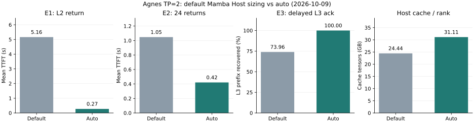

# HiCache Mamba Host auto：实现与前后对照实验

日期：2026-10-09。代码基线：`c7be3e935b`（本地 `/mnt/sglang-fork`）。

## 结果

在 Agnes 当前配置下，`--hicache-mamba-ratio auto` 将每 rank 的 Host Mamba 池从 **81 个槽位扩至 251 个**。三次 131K 前缀回访的平均 TTFT 从 **5.160 s 降至 0.274 s**（降低 94.7%，18.8 倍）；12 会话多轮场景的回访平均 TTFT 从 **1.047 s 降至 0.421 s**；模拟 L3 写入积压后，原始前缀的 L3 可恢复比例从 **74.0% 提升至 100.0%**。

代价：**每 rank 多 6.668 GB Host 内存；一套 TP=2 服务多 13.336 GB**。包含主模型 KV、DFLASH draft KV 和 Mamba 的 L2 缓存张量总量从 **24.444 GB/rank 增至 31.112 GB/rank**（+27.3%）。这是扩大 Mamba Host 容量带来的收益，未改变 L3 传输实现或状态保存频率。



## 参数实现

新增可选参数 `--hicache-mamba-ratio`，支持 `auto` 或正的有限数值。不传时保留旧逻辑：Mamba Host 池跟随 `--hicache-ratio`；使用 `--hicache-size` 时仍按设备各池字节比例分配预算。显式设置新参数时，Mamba 独立分配，`--hicache-size` 只约束主 KV 池（有 SWA 时在 full/SWA KV 之间分配），Mamba 内存另外增加。

`auto` 使用已经建好的主模型 Host KV 池实际 token 容量，而不是启动前估计：

```text
chunk_states = ceil(host_kv_tokens / chunked_prefill_size)
host_states  = max(chunk_states + max_running_requests, device_states + 1)

本配置：ceil(988928 / 4096) + 9 = 242 + 9 = 251
旧配置：int(40 × 2) + 1 = 81
手动 ratio=6：int(40 × 6) + 1 = 241
```

日志中 6.28 是最终容量比 `251/40` 四舍五入后的值。构造器自身会加 1 槽，实际传入 `(251 - 0.5)/40`，使最终分配数与日志一致。此前实现多分配 1 槽的问题已修正。设备池存在 `host_capacity_tokens` 时使用该容量，避免共享/逻辑池的 `size` 误导比例。额外 9 槽用于请求完成检查点和预取暂存的余量；它是经验余量，不是全场景锁定状态数的数学上界。

未启用 chunked prefill（chunk 为 None 或非正值）时打印警告，退回通用 `hicache_ratio`。非法数值和空设备池会报明确错误。参数仍需显式启用，通用默认值没有改为 auto。

实现位置：

- [参数字段](../../python/sglang/srt/arg_groups/fields/memory.py)
- [参数顺序](../../python/sglang/srt/arg_groups/field_order.py)
- [Mamba / Mamba+SWA 池组装](../../python/sglang/srt/mem_cache/hybrid_cache/hybrid_pool_assembler.py)
- [单元测试](../../test/registered/unit/mem_cache/test_hybrid_pool_assembler.py)

## 实验设置与测量口径

单机 4×RTX 5090（每卡 32607 MiB）。默认组用 GPU 0,1，auto 组用 GPU 2,3；两套 TP=2 服务分别连接本地、互相独立的 Mooncake master 和 96 GiB 存储 segment。HTTP 与 master 均绑定 127.0.0.1，实验没有连接产线 Mooncake。两组并行发送相同种子的 token 序列。默认组使用同一代码但不传新参数；两组均带 Host 分配计数探针，normal 阶段不注入回写延迟。

配置沿用产线参考命令：Agnes modelopt_fp4，KV fp8_e4m3，Mamba bfloat16，chunk=4096，page=256，max-running-requests=9，device Mamba=40，hicache-ratio=2，direct/page_first_direct，write_through，DFLASH block=8。所有请求生成 4 token、ignore_eos=true、temperature=0。

TTFT 是客户端 `/generate` SSE 首个生成事件到达时间，包含 JSON 请求、排队、prefetch 和 prefill。读取 SSE 使用 `iter_lines(chunk_size=1)`，避免默认缓冲对短响应的额外等待。不同组的 L3 请求仍会共享这台机器的 CPU/内存带宽，因此本结果不是独立机器或真实跨机网络的吞吐测量。

`device/host/storage` 来自服务端 `cached_tokens_details`。E2 百分比的分母是完整输入 token 数，因此新增 token 也在 recompute 中。E3 L3 恢复率的分母是 6×131072 个原始前缀 token，排除回访新增的 256 token。随机 token 工作负载用于控制缓存路径，不代表真实对话的语义分布或模型质量评估。

## E1：长前缀被 GPU 淘汰后回访

流程：X=131072 token 冷请求 → 3 或 5 个不同的同长度 filler → 等待 0 或 20 秒 → X+256。每轮清空 L1/L2，种子各不相同；L3 segment 只服务当前实验。所有回访都确认 `device=0`，因此没有把 L1 命中当成 L2 收益。

| seed | filler 数 | 静置 | 默认 TTFT | auto TTFT | 默认 host / storage token | auto host / storage token |
|---|---:|---:|---:|---:|---:|---:|
| 1101 | 3 | 0 s | 6.227 s | 0.261 s | 126,976 / 4,096 | 131,072 / 0 |
| 1102 | 3 | 20 s | 3.976 s | 0.271 s | 126,976 / 4,096 | 131,072 / 0 |
| 1103 | 5 | 20 s | 5.276 s | 0.291 s | 126,976 / 4,096 | 131,072 / 0 |

**统计口径修正：表里的 storage=4096 不是重算量，也不是实际 L3 I/O 量，而是预取插入 Host 树后新增的前缀长度。** 默认与 auto 均只 prefill 新增的 256 token。默认组的实际日志是 `completed=131072 matched=126976 loaded=4096`：L3 已传回完整的 131072-token KV 前缀，插入时才发现 126976 token 的 KV 已在 Host，释放重复的暂存槽位，将差值 4096 记入 storage 来源统计。此前将该栏描述为“只补读末尾 4096”不准确。

Mamba 状态被淘汰后，KV 单独常驻不能成为可恢复的混合缓存匹配点。预取从可恢复匹配边界发起，而不是从“只看 KV 的最长 Host 边界”发起；本例因此重读整段 KV。代码中 `loaded_from_storage = completed_tokens - insert_result.prefix_len`（[来源](../../python/sglang/srt/mem_cache/unified_radix_cache.py#L2361)），发生在 L3 传输、Host 插入之后。实际传输循环见 [CacheController._page_transfer](../../python/sglang/srt/managers/cache_controller.py#L1075)。

按本配置的池布局估算，整段主 KV 为 131072×16384 = 2.147 GB/rank，draft KV 为 131072×5120 = 0.671 GB/rank，加一个末尾 Mamba 状态约 0.039 GB，总计约 **2.858 GB/rank**。如果只补缺失的 4096 token KV 与一个状态，则约 **0.127 GB/rank**。该字节数是布局推算，非本次单独采集的网络字节计数；最终 storage token 数不能替代传输字节计数。

原始 ReqTimeStats 将新增延迟定位在首次 forward 之前。queue_duration 覆盖入队至首次 forward，包含存储预取等待，不能简单解释为有其他推理请求排在前面。

| seed | 配置 | forward 前等待 | forward 总时长（含生成） |
|---|---|---:|---:|
| 1101 | 默认 | 5.966 s | 0.274 s |
| 1102 | 默认 | 3.693 s | 0.288 s |
| 1103 | 默认 | 5.006 s | 0.268 s |
| 1101 | auto | 0.004 s | 0.270 s |
| 1102 | auto | 0.023 s | 0.257 s |
| 1103 | auto | 0.017 s | 0.277 s |

forward 时长包含本次请求的生成过程，不等于客户端首事件 TTFT。日志同时确认 `#new-token: 256, #cached-token: 131072`，说明几秒差距并非重算 4096 token 导致。现有日志未把查询、Host 分配、KV 读取、状态读取和 TP 同步逐项拆开，不能把所有等待都归为纯网络传输。

auto 的三次回访均完整命中 L2，`storage=0`，避开了整段 L3 重读路径。等待 20 秒后默认组仍然出现整段重读，说明该场景不只是写穿队列瞬时未排空。0 秒与 20 秒的时延变化还可能受共享 CPU/内存带宽和回写竞争影响；三组 seed/filler 不同，不能单凭该表定量分离这些影响。

所有 E1 冷请求与 filler 的平均 TTFT：默认 **20.439 s**，auto **20.503 s**。因此收益集中在缓存恢复路径，不能表述成冷 prefill 算力加速。

## E2：12 会话轮流回访，3 轮

每个会话初始 65536 token，每轮新增 2048 token，12 个会话按相同顺序依次请求。第 0 轮为冷请求，第 1/2 轮为回访；总上下文工作集大于 GPU KV 容量而小于 Host KV 容量。

| 轮次 | 配置 | TTFT mean | p50 | max | device | host | storage | recompute |
|---|---|---:|---:|---:|---:|---:|---:|---:|
| 0 | 默认 | 7.190 s | 7.197 s | 7.211 s | 0.0% | 0.0% | 0.0% | 100.0% |
| 0 | auto | 7.210 s | 7.211 s | 7.225 s | 0.0% | 0.0% | 0.0% | 100.0% |
| 1 | 默认 | 1.675 s | 2.380 s | 2.728 s | 0.0% | 93.4% | 3.5% | 3.0% |
| 1 | auto | 0.420 s | 0.415 s | 0.473 s | 0.0% | 97.0% | 0.0% | 3.0% |
| 2 | 默认 | 0.420 s | 0.420 s | 0.425 s | 0.0% | 97.1% | 0.0% | 2.9% |
| 2 | auto | 0.423 s | 0.422 s | 0.425 s | 0.0% | 97.1% | 0.0% | 2.9% |

24 次回访汇总：

| 指标 | 默认 | auto |
|---|---:|---:|
| 平均 TTFT | 1.047 s | 0.421 s |
| p50 | 0.420 s | 0.421 s |
| p95（nearest-rank） | 2.651 s | 0.425 s |
| L3 token 总量 | 28,672 | 0 |
| 重算 token 总量（含新 token） | 49,152 | 49,152 |

第 1 轮平均 TTFT 为 1.675 → 0.420 s，第 2 轮两组都约 0.42 s，已经没有明显增益。该现象与第一次回访刷新末尾检查点后默认组也能保留可恢复状态一致；不能将首轮收益外推为每一轮都加速。该负载检验连续多轮状态能否留在 L2，而不只是一次精心构造的回访。它依赖会话返回同一实例；跨实例路由时主要依赖 L3，不能直接外推这项 TTFT 收益。

## E3：写入积压是否丢失可恢复前缀

单次故障注入实验：并发提交 6 个不同的 131072-token 请求，由调度器执行 prefill。对两组相同地将每 rank 的 L3 回写操作完成速度限制到约 2400 token/s，等待 master key_count 连续 4 次采样稳定，再清空 L1/L2，逐个回访原前缀+256。

限速补丁在实际 `_page_backup` 完成后延迟返回，使 Host 槽位在 ack 前持续被锁定，模拟下游回写积压。它验证的是**锁定槽位不足及回写完整性**，不是实测网络限速，也不能证明几百实例共享 Mooncake 时的总吞吐。补丁仅用于本地实验，最终生产代码已移除；复现实验时按下节临时应用。

| prompt | 默认 storage token / 131072 | auto storage token / 131072 | 默认 TTFT | auto TTFT |
|---|---:|---:|---:|---:|
| 0 | 131,072 | 131,072 | 5.181 s | 5.706 s |
| 1 | 86,016 | 131,072 | 13.110 s | 5.034 s |
| 2 | 131,072 | 131,072 | 5.820 s | 4.991 s |
| 3 | 131,072 | 131,072 | 6.875 s | 4.693 s |
| 4 | 53,248 | 131,072 | 16.978 s | 5.081 s |
| 5 | 49,152 | 131,072 | 17.400 s | 5.306 s |

汇总：默认 **581,632/786432 = 74.0%**；auto **786,432/786432 = 100.0%**。回访平均 TTFT 为 **10.894 s → 5.135 s**。前缀覆盖率提升比单看 TTFT 更直接：较低 L3 命中率会导致剩余前缀重算。

默认组 drain 约 313.1 s，auto 约 403.8 s（自并发 prefill 发起计时，包含稳定采样等待）。auto 保存了更多完整前缀，所以在相同限速下可能需要更久排空；不能把较短排空时间解释成默认组写得更快。

Host 分配探针（每 rank 最后采样的累计值，探针每 50 次或失败时记录，sampled_calls 与 min_available_observed 仅是已观测采样值；不同 rank 是同一 TP 请求的副本，不应当作独立实验）：

```json
{
  "base": {
    "0": {
      "sampled_calls": 200,
      "failures": 50,
      "min_available_observed": 0
    },
    "1": {
      "sampled_calls": 200,
      "failures": 50,
      "min_available_observed": 0
    }
  },
  "auto": {
    "0": {
      "sampled_calls": 150,
      "failures": 0,
      "min_available_observed": 103
    },
    "1": {
      "sampled_calls": 150,
      "failures": 0,
      "min_available_observed": 103
    }
  }
}
```

旧日志中的 ratio=6 对照仅作为历史背景，本报告的表格全部来自本次 **默认 vs auto** 实测。

## Host 内存变化

Host 使用十进制 GB（10^9 bytes）；GPU CSV 使用 MiB。单个 rank 的 Mamba 状态含 48 层的 temporal 与 conv：

```text
temporal = 48 × 24 × 128 × 128 × 2 = 37,748,736 bytes
conv     = 48 × 5120 × 3 × 2      =  1,474,560 bytes
合计                               39,223,296 bytes/slot
```

| L2 张量 / 每 rank | 默认 | auto | 增量 |
|---|---:|---:|---:|
| 主模型 KV（988928 token） | 16.203 GB | 16.203 GB | 0 |
| DFLASH draft KV（989184 token） | 5.065 GB | 5.065 GB | 0 |
| Mamba（81 → 251 slot） | 3.177 GB | 9.845 GB | 6.668 GB |
| 合计 | 24.444 GB | 31.112 GB | 6.668 GB |
| 一套 TP=2 服务合计 | 48.889 GB | 62.225 GB | 13.336 GB |

以上按模型形状和实际池容量计算；启动日志分别打印 16.20、5.06、3.18 / 9.85 GB，与计算一致。这些是缓存张量容量，不含 Python、tokenizer、CUDA runtime、临时缓冲或 Mooncake 的独立存储 segment。

启动后请求前的进程采样：两名 scheduler 的 RSS，默认 **28.719 / 28.719 GB**，auto **35.382 / 35.381 GB**；整套服务进程的 PSS 总量 **60.258 → 73.612 GB**。进程数据包含缓存之外的开销，与理论新增约 13.34 GB 相符。按进程组采样，排除独立 Mooncake segment；用 PSS 汇总避免 fork 共享页在 RSS 中重复计数。

GPU 采样见 `mamba_ratio_auto/results/normal-gpu.csv`，没有改动设备 KV/Mamba 池尺寸；几 MiB 的组间运行时波动不能算作 Host 配置引入的显存容量变化。

## 边界与使用建议

对于当前 4096 chunk、长前缀和充足 Host 内存配置，可以在原命令追加：

```bash
--hicache-mamba-ratio auto
```

auto 根据实际 Host KV 容量、chunk 与并发数重算，避免更改这些参数后还手工沿用 6。这里计算出的 251 槽比手动 ratio=6 的 241 槽多 10 槽，覆盖向上取整和请求余量。

这个公式是**按 chunk 密度的容量估算**。短请求、很多短分支、轮次边界检查点、radix 分裂、更多预取或长时间锁定状态都可能提高状态/token 密度，因此不能承诺所有负载下不淘汰状态或永不漏写。未覆盖 buffer_only、所有模型架构、跨机真实网络、几百实例竞争或长时间稳定性。Mamba+SWA 的预算分配有 CPU 单元测试，端到端性能只测了当前 Agnes 混合 GDN 模型。

本次两个实例共增加约 **13.336 GB** Host 内存（仅 auto 组相对它自己的 TP=2 baseline；若两套都切 auto，则增加约 26.672 GB）。产线按**每套 TP=2 +13.336 GB**累加，显式 Mamba 参数的额外内存不包含在 `hicache-size` 的 KV 预算中。将来若减少中间 Mamba 检查点，应重新评估此估算。

## 验证与复现

单元测试：**23 passed，17 subtests passed**。覆盖旧默认、显式数值、auto 取整、chunk 变化、最小池容量、未启用 chunk 的回退、非法值、共享设备池容量以及 Mamba / Mamba+SWA 在固定 Host 预算下的兼容行为。新增参数 CLI 解析通过（auto、6、3.5、不传）。Ruff/isort 检查通过。

E1/E2 与短前缀 L1 sanity 均成功返回 4 token；E3 的并发和回访请求也返回 4 token。短前缀的第二次请求可命中设备缓存。这里没有把随机 token 输出当作模型质量或逐 token 等价性证明。

脚本：[run.py](mamba_ratio_auto/run.py)、[launch.sh](mamba_ratio_auto/launch.sh)、[store.py](mamba_ratio_auto/store.py)、[summarize.py](mamba_ratio_auto/summarize.py)。运行前需要四张空闲 GPU、可用的本地端口 30080/30081、50099/50100、9099/9100，足够的 Host 内存及已安装依赖的仓库 `.venv`。

```bash
cd /mnt/sglang-fork
.venv/bin/python benchmark/hicache/mamba_ratio_auto/run.py \
  --phase normal --out /mnt/yeyi0003/agnes-p0/repro-auto-normal

# 以下补丁只用于本地慢回写实验；不要应用到产线。
git apply benchmark/hicache/mamba_ratio_auto/fault_injection.patch
.venv/bin/python benchmark/hicache/mamba_ratio_auto/run.py \
  --phase slow --out /mnt/yeyi0003/agnes-p0/repro-auto-slow
# 实验结束后移除临时探针及限速逻辑（失败退出也需执行）。
git apply -R benchmark/hicache/mamba_ratio_auto/fault_injection.patch

.venv/bin/python benchmark/hicache/mamba_ratio_auto/summarize.py \
  --normal /mnt/yeyi0003/agnes-p0/repro-auto-normal \
  --slow /mnt/yeyi0003/agnes-p0/repro-auto-slow \
  --out /mnt/yeyi0003/agnes-p0/repro-auto-summary.json
```

脚本保存逐请求 JSONL、启动日志、Host 进程内存和 GPU 快照，并在完成或异常时停止它启动的子进程组。故障注入补丁的应用/撤销是独立步骤。输出目录应使用新的空目录。

本次原始大日志保存在 `/mnt/yeyi0003/agnes-p0/auto-normal/` 和 `/mnt/yeyi0003/agnes-p0/auto-slow/`。仓库内保留 [汇总](mamba_ratio_auto/results/summary.json)、逐请求记录和内存快照（`mamba_ratio_auto/results/`），可独立重算报告数字。
